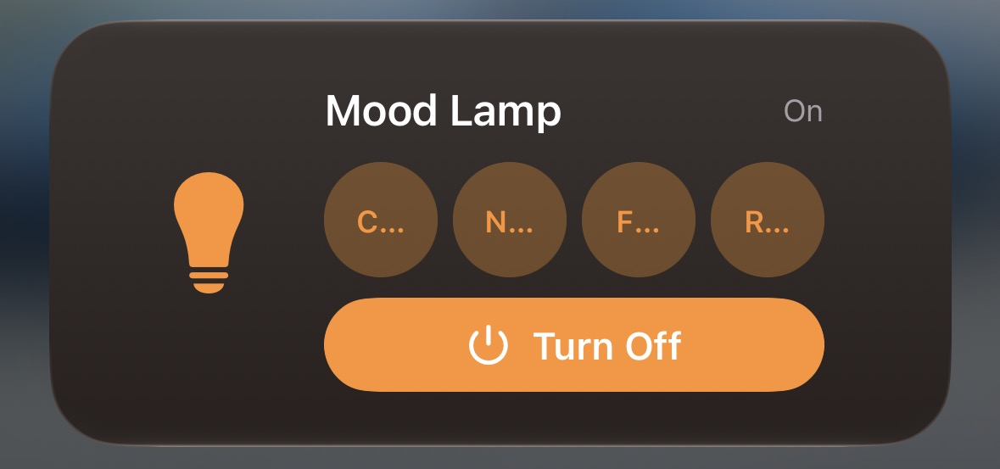
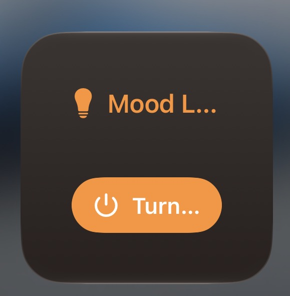

  

<h1 align="center">Mood Lamp</h1>

  <strong>The tactile, private companion for your smart lighting.</strong> 
  Instant, local control designed for iPhone, Mac, and iPad.

  <a href="#experience">Experience</a> •
  <a href="#product-highlights">Highlights</a> •
  <a href="#quick-start">Get Started</a> •
  <a href="#privacy--architecture">Privacy & Architecture</a>

---

## Thoughtfully simple. Instantly responsive.

Most smart home apps are weighed down by account creation, third-party clouds, sluggish sync times, and cluttered navigation. 

**Mood Lamp** takes the opposite approach. Built specifically for WiZ lights, it communicates directly with your lamps over your local network. No user accounts. No cloud dependencies. No tracking. Just an intentional, distraction-free control deck that responds the millisecond you touch it.

 

  
  &nbsp;&nbsp;
  
  &nbsp;&nbsp;
  

---

## Product Highlights

### ⚡ True Local Speed
Commands are sent directly across your home Wi-Fi via UDP. The result is instantaneous, sub-millisecond control without round-trips to distant cloud servers.

### 🔮 Living Ambient Interface
The central orb isn't just a button—it breathes and pulses in harmony with your lamp, mirroring your light's current brightness, color, and warmth in real time with subtle haptic feedback.

### 🔍 1-Tap Auto Discovery
No hunting down router dashboards. Mood Lamp automatically scans your local subnet and pairs with your lamps in seconds. Easily manage and switch between multiple lamps across rooms.

### 🎨 Curated Scenes & Custom Palettes
Cycle through 14 bespoke ambient lighting scenes—from *Candlelight* and *Fireplace* to *Ocean* and *Sunset*—complete with color previews. Pin your most-loved scenes as favorites and save custom colors to your quick-access palette.

### 🌅 Adaptive Circadian Lighting
Follow the natural rhythm of daylight. When enabled, Mood Lamp gently warms during dawn, transitions to energizing crisp white at midday, and softens into a relaxing amber as evening settles.

### 🎵 Music Mood
Turn your room into an extension of your music. Mood Lamp can automatically extract the dominant aesthetic palette from your currently playing album artwork and illuminate your space to match.

---

## iOS at Your Fingertips

Stay in control without having to keep the app open.

  
  &nbsp;&nbsp;&nbsp;&nbsp;
  

- **Interactive Home Screen Widgets**: Glance at your lamp's current brightness and power state, or trigger your favorite pinned scenes straight from your Home Screen.
- **Control Center (iOS 18)**: Toggle your lamp instantly from the Control Center swipe-down deck.
- **Siri Shortcuts & Automation**: Native App Intents let you integrate lighting into your morning alarms, sleep focus routines, or voice shortcuts.

---

## Quick Start

1. **Connect**: Ensure your Apple device and WiZ bulb are on the same local Wi-Fi network.
2. **Enable Local Mode**: In the official WiZ app, ensure **Local integrations** is toggled **On**.
3. **Open Mood Lamp**: The app will automatically discover your bulb. Select it, and you're ready to set the mood.

---

## Privacy & Architecture

- **100% Local**: All communication remains strictly inside your private network on UDP port `38899`.
- **Zero Telemetry**: No third-party analytics, user tracking, or accounts.
- **Resilient Rediscovery**: Lamps are tracked via their permanent hardware MAC address, ensuring seamless reconnection even if your router reassigns IP addresses.
- **Shared App Group**: Widgets and intents share states securely via Apple's sandboxed App Group container (`group.com.preritrudrakarpersonalteam.bulb`).

---

## Built with Modern Apple Technologies

- **Swift 6 & SwiftUI** with complete actor isolation
- **WidgetKit** & **ControlWidget** (iOS 18)
- **App Intents** for seamless Siri & Shortcuts integration
- **Network.framework** for lightweight, non-blocking UDP communication
- **MediaPlayer** for real-time album artwork color sampling

 

  Crafted for calm, comfortable spaces.

