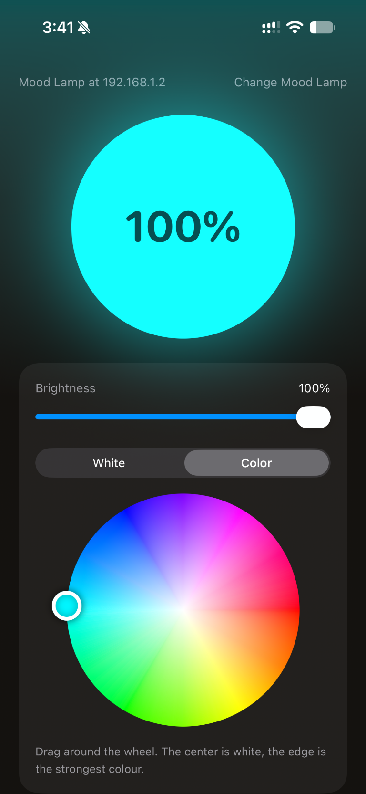
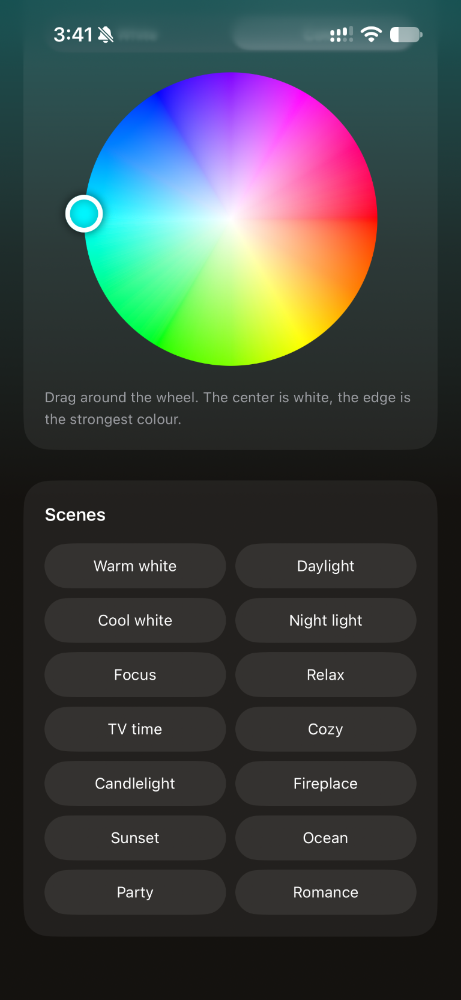
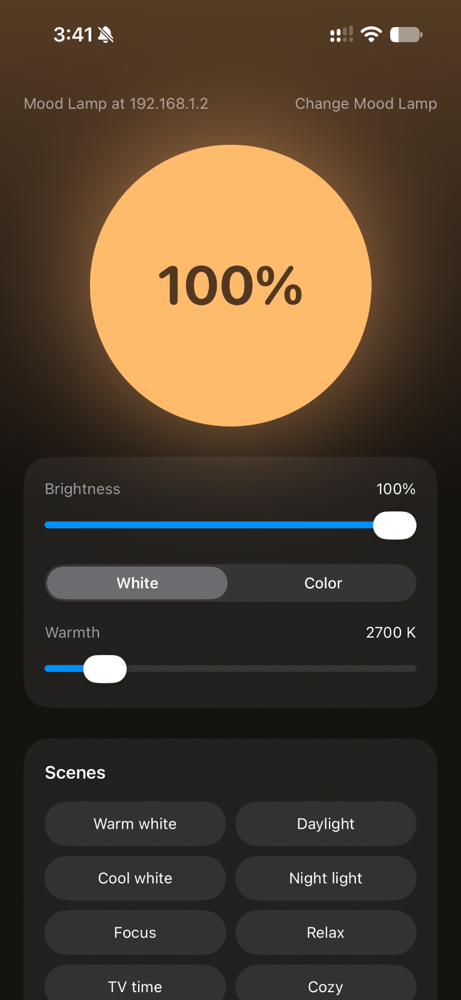

<p align="center">
  
</p>

<h1 align="center">Mood Lamp</h1>

<p align="center">
  A calmer, more direct way to control your WiZ smart bulb.
</p>

<p align="center">
  iPhone · Mac · Home Screen widget · Siri Shortcuts
</p>

---

## Sample screens

These sample files show the app's main controls and scene presets.

<p align="center">
  
  
  
</p>

Mood Lamp puts the everyday controls for a WiZ bulb in one warm, focused interface. Change brightness, tune white temperature, pick a color, or set a scene—and control the lamp from an iPhone widget or a Siri Shortcut when you do not want to open the app.

## What you can do

- **Control the essentials:** switch the lamp on or off, adjust brightness, choose a white temperature, and pick a color.
- **Set the mood:** choose from built-in scenes, including Cozy, Candlelight, Fireplace, Sunset, Ocean, Focus, and Relax.
- **Control it at a glance:** add the small or medium Mood Lamp widget to the iPhone Home Screen to see the last known state and toggle the bulb. The medium widget also has quick buttons for Cozy, Night light, Focus, and Relax.
- **Use your voice:** run the included Siri Shortcuts to turn the lamp on or off, choose a scene, or set brightness.
- **Stay in sync:** while the app is open, it checks the bulb regularly so changes made elsewhere can appear in the app.

## Why it works this way

Mood Lamp talks directly to the bulb over your local network using WiZ's UDP control protocol on port **38899**. That keeps ordinary controls local and avoids requiring a Mood Lamp account or a separate Mood Lamp server.

The iPhone widget is a WidgetKit extension. The app and widget share the configured bulb address and last known power state through an Apple App Group. When you use the widget's toggle, it checks the bulb's current state before changing it; scene buttons set the selected scene directly. The widget is intended as a quick control—not a promise of continuous, real-time monitoring while iOS is refreshing it in the background.

## Get started

1. Connect your iPhone or Mac and WiZ bulb to the same local Wi-Fi network.
2. In the WiZ app, enable **Local integrations** for the bulb.
3. Open Mood Lamp and enter the bulb's IP address. You can find it in the WiZ app or your router's connected-device list.
4. Allow Mood Lamp to access your local network if your device asks.
5. Use the controls in the app. On iPhone, add the widget from **Edit Home Screen → Add Widget → Mood Lamp**.

If the bulb is reported offline, confirm its IP address, check that both devices are on the same Wi-Fi network, and make sure Local integrations is enabled. Guest Wi-Fi, client isolation, VPNs, or router rules can prevent local device-to-device traffic.

## Build from source

Mood Lamp is a SwiftUI app built with Xcode. The project contains the app target and an iPhone WidgetKit extension.

Open `Mood Lamp.xcodeproj` in Xcode and select the **Mood Lamp** scheme. To build from Terminal:

```sh
# iPhone Simulator app and embedded widget
xcodebuild -project "Mood Lamp.xcodeproj" \
  -scheme "Mood Lamp" \
  -configuration Debug \
  -sdk iphonesimulator \
  CODE_SIGNING_ALLOWED=NO build

# macOS app
xcodebuild -project "Mood Lamp.xcodeproj" \
  -scheme "Mood Lamp" \
  -configuration Debug \
  -sdk macosx \
  CODE_SIGNING_ALLOWED=NO build
```

To install on a physical iPhone or distribute the app, select your Apple Developer team in Xcode and ensure the App Group below is available to that team. Simulator builds do not require device provisioning.

## Project map

| Location | Purpose |
| --- | --- |
| `Mood Lamp/MoodLampApp.swift` | SwiftUI app, lamp controls, and state polling |
| `Mood Lamp/WizClient.swift` | Local UDP communication with the WiZ bulb |
| `Mood Lamp/MoodLampIntents.swift` | Siri Shortcuts and scene definitions |
| `Mood Lamp Widget/MoodLampWidget.swift` | iPhone Home Screen widget and its toggle action |
| `Mood Lamp/Assets.xcassets/AppIcon.appiconset/` | App icon artwork and platform icon sizes |

## Local network and privacy

The bulb is configured by its IP address, which is kept in the app's preferences and shared with the widget using the App Group `group.com.preritrudrakarpersonalteam.bulb`. The app and widget communicate directly with the bulb on the local network. A reachable bulb and WiZ Local integrations are required for controls to work.

For a device build, the App Group must be enabled for the app and widget identifiers in the signing team's Apple Developer configuration. The app's local-network permission description explains why it needs access.

## Built with

Swift · SwiftUI · WidgetKit · App Intents · Network.framework
